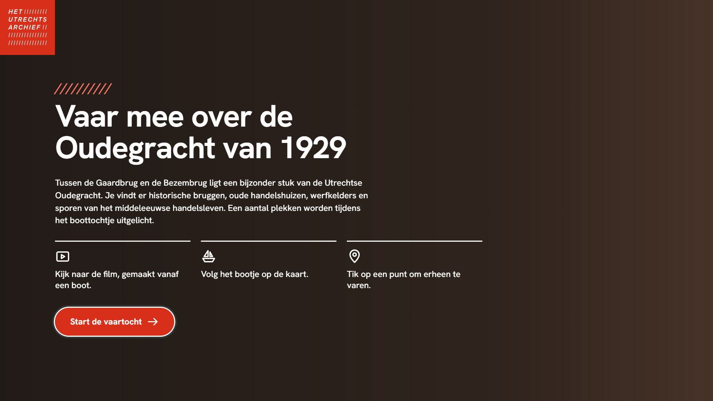
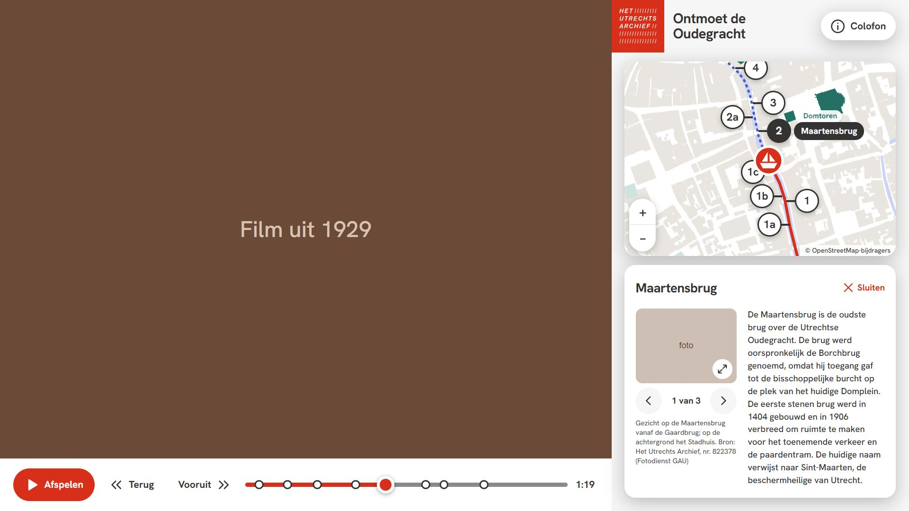
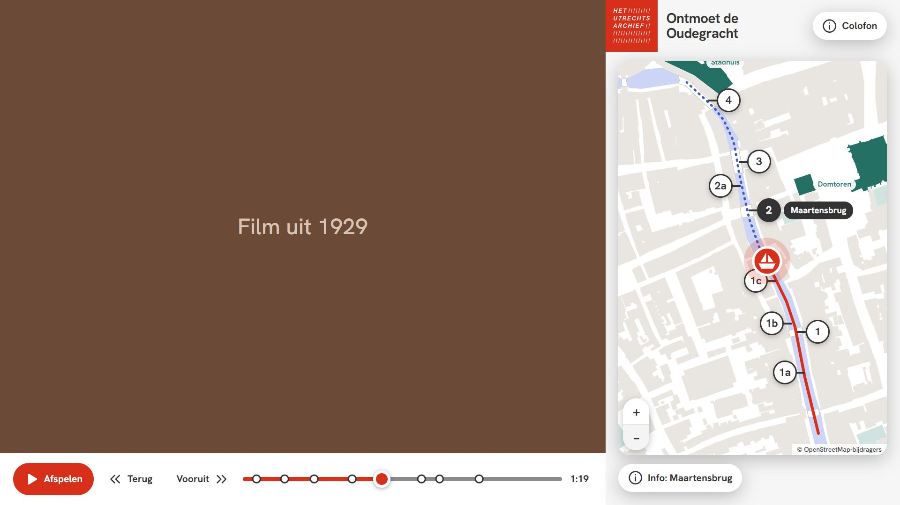
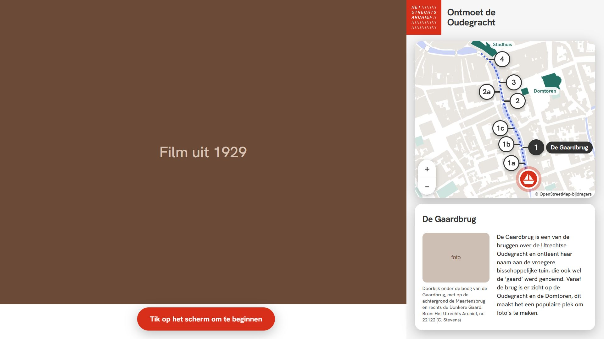

# Schermontwerp

Het schermontwerp in de huisstijl van Het Utrechts Archief, uitgewerkt vanuit de wireframes in het [technisch ontwerp](technisch-ontwerp.pdf). Het ontwerp is meteen in HTML en CSS gemaakt. Op de plek van de film en de foto's staan hier vlakken, omdat het beeld van het archief is.

## Drie versies

1. De eerste versie volgde de huisstijlmanual uit 2008, met donkerpaars en goud. Die zag er ouderwets uit.
2. De tweede versie volgde de huidige website van het archief, want dat vraagt de opdracht. De film vulde het hele scherm, maar daardoor viel een deel van de film weg en lagen de kaart en de informatie eroverheen.
3. In deze versie is de hele film te zien en ligt er niets meer overheen. De stijl van de tweede versie is gebleven.

## Schermen

### Startscherm

### Informatiekaartje bij een punt

### Hoofdscherm met het kaartje dicht

### Wachtstand

## Keuzes

- **Kleuren:** het rood, groen en blauw van [hetutrechtsarchief.nl](https://hetutrechtsarchief.nl/), op wit. Rood is voor wat je kunt doen en waar je bent. Blauw is het water, groen zijn de bekende gebouwen.
- **Lettertype:** Hanken Grotesk, een vrije letter die lijkt op de Akzidenz Grotesk van het archief. Het bestand staat in de repository, dus er is geen internet voor nodig.
- **Logo:** de witte versie in een rood vlak, linksboven tegen de rand.
- **Schuine streepjes:** het kenmerk uit het logo komt terug boven de titel op het startscherm.
- **Film:** is het belangrijkste en krijgt daarom twee derde van het scherm. De hele film (4:3) is te zien en er ligt niets overheen. Alleen achter het startscherm vult de film het hele scherm.
- **Kaart:** eigen kaart met alleen water, huizen, bruggen en bekende gebouwen. Zonder winkels en icoontjes zie je meteen waar de boot is. De kaart werkt ook zonder internet.
- **Afbeeldingen:** per plek een tot drie afbeeldingen om door te bladeren. Een tik op de foto laat hem groot zien.
- **Punten op de kaart:** de bruggen hebben een cijfer en staan rechts van het water. De plekken ertussen hebben een cijfer met een letter en staan links, net als in het bronmateriaal van het archief.
- **Groot scherm:** alle maten groeien mee met het scherm.

## Contrast

WCAG 2.1 AA vraagt minimaal 4,5 voor tekst en 3 voor onderdelen van de bediening.

| Onderdeel | Voorgrond | Achtergrond | Contrast |
| --- | --- | --- | --- |
| Tekst op witte vlakken | `#333333` | `#ffffff` | 12,6 |
| Bronvermelding | `#595959` | `#ffffff` | 7,0 |
| Tekst op rode knoppen | `#ffffff` | `#d72f19` | 4,9 |
| Namen op de kaart | `#247065` | `#ffffff` | 5,9 |
| Tijdlijn, nog niet gevaren | `#8a8a8a` | `#ffffff` | 3,5 |
